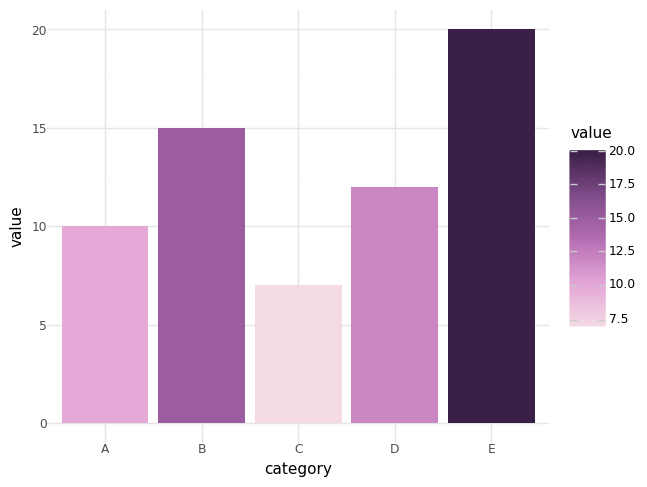

# Load palette

::: pypalettes.load_palette

## Examples

```py
# mkdocs: render
import seaborn as sns
from pypalettes import load_palette

palette = load_palette("Fun")  # list of colors

df = sns.load_dataset("penguins")

g = sns.lmplot(
    data=df,
    x="bill_length_mm",
    y="bill_depth_mm",
    hue="species",
    palette=palette,
)
```

- In plotnine

```py
# mkdocs: render
import pandas as pd
from plotnine import ggplot, aes, geom_bar, theme_minimal, scale_fill_gradientn
from pypalettes import load_palette

df = pd.DataFrame({"category": ["A", "B", "C", "D", "E"], "value": [10, 15, 7, 12, 20]})

colors = load_palette("Arches2", reverse=True)

(
    ggplot(df, aes(x="category", y="value", fill="value"))
    + geom_bar(stat="identity")
    + scale_fill_gradientn(colors=colors)
    + theme_minimal()
)
```



[**See all palettes**](https://python-graph-gallery.com/color-palette-finder/){target="\_blank"}
